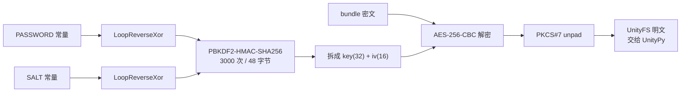

# Rizline PC 版 Bundle 解包

`pc_unpack.py` 用于直接解包 **PC（StandaloneWindows64）** 安装目录里的资源，不需要下载，也不需要 vgmstream：

- PC 的 `*.bundle` 是 AES-256-CBC 加密的，脚本会先解密再交给 UnityPy
- 先读 `catalog.json` 拿到 key → bundle 映射，再扫描 `Default` 表
- 按 Disc 分类导出谱面 / 曲绘 / 音频 / 其余目录资源

> 这是 PC 版的独立工具，和仓库根目录的 Android 下载脚本 `main.py` 互不影响。

## 依赖

```
pip install UnityPy pycryptodome
```

## 需要的东西

从 PC 版游戏目录里找到数据目录（一般叫 `Rizline_Data`，里面还有一层同名目录）：

```
Rizline_Data/
└── Rizline_Data/
    └── StreamingAssets/
        └── aa/
            ├── catalog.json
            └── StandaloneWindows64/
                ├── *.bundle
                └── ...
```

## 用法

默认会去 `pc/Rizline_Data/Rizline_Data` 找资源，也可以直接指定：

```bash
# 指定游戏数据目录
python pc/pc_unpack.py --game-data "D:/Rizline/Rizline_Data/Rizline_Data"

# 分别指定 bundle 目录和 catalog
python pc/pc_unpack.py --bundle-dir "D:/.../StreamingAssets/aa/StandaloneWindows64" \
                       --catalog    "D:/.../StreamingAssets/aa/catalog.json"

# 自定义输出目录
python pc/pc_unpack.py --game-data "D:/..." --out pc/output

# Default 表所在包超过默认 1MB 阈值时（扫不到表再加）
python pc/pc_unpack.py --game-data "D:/..." --scan-all
```

| 参数 | 说明 | 默认 |
| --- | --- | --- |
| `--game-data` | 含 `StreamingAssets/aa` 的数据目录 | `pc/Rizline_Data/Rizline_Data` |
| `--bundle-dir` | 直接指定 `*.bundle` 目录，覆盖 `--game-data` | - |
| `--catalog` | 直接指定 `catalog.json`，覆盖 `--game-data` | - |
| `--out` | 输出目录 | `pc/output` |
| `--scan-max-bytes` | 扫描 `Default` 表时允许的最大 bundle 体积 | `1000000` |
| `--scan-all` | 扫描全部 bundle 找 `Default` 表 | 关 |

## 输出结构

```
pc/output/
├── meta/            Default.json 等原始表 + lookup.json
├── charts/<Disc>/<歌名 [曲师]>/
│   ├── meta.json    该曲的关卡/曲绘/谱面合并信息
│   ├── cover.png    曲绘
│   ├── audio.wav    音频（非 wav 则为 .bin）
│   └── <难度>.json  谱面
├── covers/<Disc>/   曲绘副本
├── audio/<Disc>/    音频副本
├── other/           未被关卡引用的 catalog 资源
│   ├── chart/
│   ├── illustration/
│   ├── altIllustration/
│   └── music/
└── index.json       统计、缺失清单、按 id 索引
```

## 解密原理

PC 的每个 `*.bundle` 都是**整份文件**加密的：没有文件头、没有随机 nonce、没有存 salt/iv。key 和 iv 完全由代码里的两组常量推导，因此解密是确定性的——拿同一份代码就能还原任何 PC bundle。

整体管线：



### 1. 常量

```python
PASSWORD = b"+rK3cH@3\txH|CR;b2\x00IP%O&w=j\r\n>N%sgQ1y"   # 36 字节
SALT     = bytes.fromhex("a76eb2f6ff88d70a74999ee77d762730")  # 16 字节
```

两者都是硬编码的。直接放明文太显眼，所以先做一层 `LoopReverseXor` 混淆。

### 2. LoopReverseXor：位反转 + 相邻异或

```python
def bitrev(v):                      # 8 位反转
    return int(f"{v:08b}"[::-1], 2)

def loop_reverse_xor(data):
    n = len(data)
    return bytes(bitrev(data[i]) ^ data[(i + 1) % n] for i in range(n))
```

对每个字节 `i`：

```
out[i] = bitrev(in[i]) XOR in[(i + 1) % n]
```

- `bitrev`：把 8 个二进制位左右颠倒。例如 `0xB2 = 1011 0010` → `0100 1101 = 0x4D`
- 再和**下一个字节**异或，最后一个字节回绕和第一个字节异或（`% n` 产生循环）
- 于是每个输入字节都会被前后两个字节影响一次，单一字节改动会扩散

3 字节示例 `[0x01, 0x02, 0x04]`：

| i | in[i] | bitrev(in[i]) | in[i+1] | out[i] |
| --- | --- | --- | --- | --- |
| 0 | 0x01 (0000 0001) | 0x80 (1000 0000) | 0x02 | 0x82 |
| 1 | 0x02 (0000 0010) | 0x40 (0100 0000) | 0x04 | 0x44 |
| 2 | 0x04 (0000 0100) | 0x20 (0010 0000) | 0x01 (回绕) | 0x21 |

得到混淆后的 `[0x82, 0x44, 0x21]`。这一步是**可逆**的，只用来藏常量，不提供密码学强度。

### 3. PBKDF2 派生 key / iv

```python
dk = hashlib.pbkdf2_hmac(
    "sha256",
    loop_reverse_xor(PASSWORD),   # 口令（已混淆）
    loop_reverse_xor(SALT),       # 盐（已混淆）
    3000,                         # 迭代次数
    48,                           # 输出长度
)
key, iv = dk[:32], dk[32:]
```

- 算法：`PBKDF2-HMAC-SHA256`
- 迭代 3000 次，输出 48 字节
- 前 32 字节 = AES-256 的 key，后 16 字节 = CBC 的 iv
- 因为输入固定，**每个文件的 key/iv 都相同**（不像正规做法每文件随机 iv）

### 4. AES-256-CBC 解密 + 去填充

```python
def decrypt_bundle(path, key, iv):
    ct = path.read_bytes()
    if len(ct) % 16 != 0:
        raise ValueError(f"{path.name}: length {len(ct)} not multiple of 16")
    return unpad(AES.new(key, AES.MODE_CBC, iv).decrypt(ct), 16)
```

- 密文必须是 16 的整数倍（AES 分组大小），否则不是有效 bundle
- `MODE_CBC`：每个分组先和前一分组密文异或再解密，第一组用 `iv`
- `unpad(..., 16)` 去 **PKCS#7** 填充：明文补齐到 16 的倍数，最后 1 字节记录补了几个字节，校验并去掉
- 还原出的明文以 `UnityFS` 开头，再抛给 `UnityPy.load()`

### 5. 每个文件发生的事

```
bundle 文件
  └─ read_bytes()
       └─ AES-256-CBC decrypt(key, iv)   # key/iv 固定
            └─ PKCS#7 unpad(block=16)
                 └─ UnityFS 明文 → UnityPy 解析
```

### 6. 代码入口

| 步骤 | 函数 |
| --- | --- |
| 位反转 | `bitrev` |
| 混淆 | `loop_reverse_xor` |
| 派生 key/iv | `derive_key_iv` |
| 解密 | `decrypt_bundle` |
| 调用点 | `Extractor.env()` → `UnityPy.load(decrypt_bundle(...))` |

### 7. 安全性备注

- key/iv 从硬编码常量推导，社区脚本可复现；**不要**把它当成能保护内容的强加密
- 迭代只有 3000 次，且不存 per-file salt/iv，抗暴力能力有限
- 这里的目的是**混淆资源包**，不是防御有决心的逆向

## 和 Android 脚本的区别

| | PC `pc/pc_unpack.py` | Android `main.py` |
| --- | --- | --- |
| 资源来源 | 本地安装目录 | 从 CDN 下载 |
| bundle 加密 | AES-256-CBC，需解密 | 不加密 |
| 音频 | bundle 内 `AudioClip` 直接导出 | `.acb` 需 vgmstream 转 wav |
| 网络 | 不需要 | 需要 |
| 表发现 | 扫描 bundle 找 `Default` | catalog + download |
